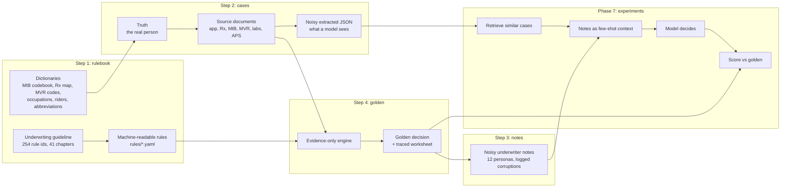
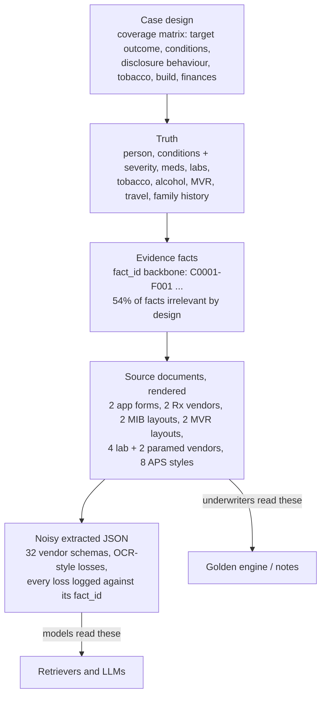
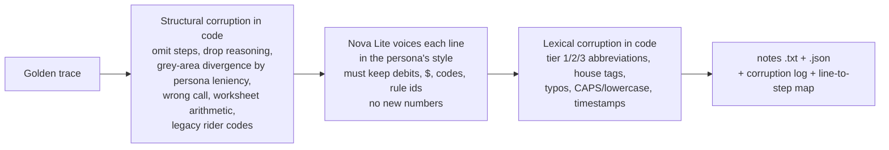
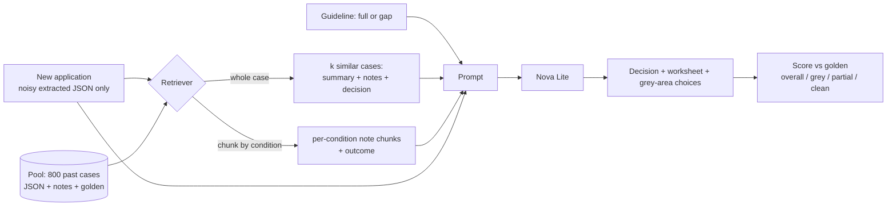
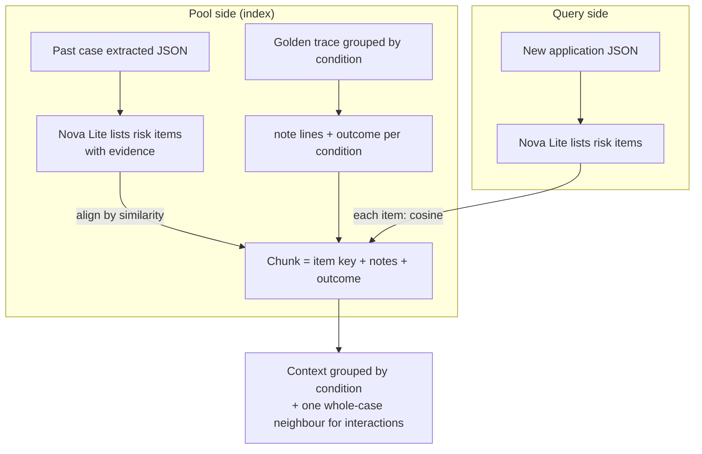

# Project overview — synthetic life-underwriting corpus and context-engineering experiments

_Written 2026-11-10. Companion docs: `CHECKPOINT.md` (handoff), `STATUS.md` (phase log), `EXPERIMENTS.md` (Phase 7
plan and every result), `PLAN.md` (original design), `reference/guidelines.md` (the underwriting manual)._

---

## 1. Goal

Life underwriting decisions depend on two things a foundation model does not have: a carrier's **house rules**
(class taxonomy, debit tables, grey-area conventions) and the **tacit knowledge in underwriter notes** (terse,
abbreviated, full of house shorthand, sometimes wrong). The project asks:

> When a new application arrives without notes, does retrieving **similar past cases and their underwriter notes**
> as few-shot context help a model reach the right decision — especially on **grey-area** and
> **partial-evidence** cases — and which definition of "similar" (which latent space) works best?

Real underwriting files are private, so the project first builds a **synthetic corpus with a known right answer**
for every case, then uses it as a test bed. Later work (a VAE or fine-tuned model that recovers structure from the
noise) builds on the same data.

## 2. Approach at a glance

The order matters: the **golden decision is built before the notes**, from the evidence alone, so the notes can be
corrupted against a fixed right answer and every corruption can be logged.

## 3. The rulebook (Step 1)

- **Class taxonomy:** non-tobacco Elite → Preferred Plus → Preferred → Standard Plus → Standard → Table 1–16;
  tobacco Preferred Tobacco → Standard Tobacco → Table Tobacco 1–16; plus flat extras, Postpone, Decline.
  **Table rating = Standard + 25% mortality per table** (debit method: every +25 net debits = one table).
- **Preferred classes** are reached through a preferred-criteria matrix (build, blood pressure, lipids, nicotine,
  family history, driving, personal history); credits (max −50) and caps apply.
- **63 impairment rating tables**, financial justification, foreign nationals, travel, occupation, avocations,
  aviation, alcohol/drugs, requirements grid, combination rules, and **12 invented riders** with opaque codes
  (WP, WMD, ADB, CTR, GIO, ABR, CIA, XCR, OIR, ROP-T, KPE, LTA) and eligibility rules.
- **Grey areas (GRY-0 … GRY-12):** documented ranges where competent underwriters differ (borderline values,
  ambiguous Rx with no APS, unknown cancer stage, MIB code supported only by a "rule-out" note, …). Each has a
  default and defensible alternatives.
- **6-digit MIB codebook** (184 condition codes + degree/source/qualifier digits), 200-drug Rx map with ambiguous
  indications, 43 MVR codes, 56 occupations.
- Guideline markdown and rule YAML are cross-checked by script (`src/check_rules.py`).

## 4. Synthetic data methodology (Step 2) — and why the noise is there

### 4.1 Layers

- **1000 cases**, seeded and reproducible (regeneration is byte-identical). A `fact_id` backbone ties every layer
  together so any statement in a golden trace or a note can be traced to the documents.
- **APS (attending physician statements)** are written by Nova Lite/Pro from a structured spec in 8 styles
  (Epic progress notes, Athena summaries, eCW problem lists, small-practice typed, handwritten scan, specialist
  letter, hospital discharge, foreign translated). Every LLM-written record is fact-checked against the spec
  (no unlisted drugs or diagnoses; must-include values present), else a template is used.
- Underwriters (and the golden engine) see the **source documents**; downstream models see the **noisy extracted
  JSON**, as they would after OCR/vendor feeds in production.

### 4.2 Injected noise, and the reason for each kind

| Layer | Noise injected | Why |
|---|---|---|
| Evidence | **54% of facts are irrelevant** (normal labs, routine visits, benign meds, old resolved items, distractor MIB codes) | Real files are mostly noise; a model must find the few facts that rate |
| Applicant behaviour | Disclosure realism: honest 932 items, **omitted 336**, **minimized 166**, **misremembered 148**, untraceable 48; tobacco omitted 119 / minimized 98 | Applications lie or forget; third-party data (Rx, MIB, MVR, cotinine) must catch it |
| Documents | Vendor/format variety (32 schemas), stale APS, copy-forward text, "rule-out" notes, missing records | The same fact arrives in many shapes; partial evidence is the norm |
| Extraction (OCR-style) | Fields **dropped** (1525), units lost/wrong (421), merged cells (328), flags lost (319), garbled dates (205), **misread digits** (153, e.g. 8→B, 1→l), truncated APS pages (18) | What a model actually receives after OCR; a misread MIB digit changes meaning |
| Underwriter notes | Personas, omissions, abbreviations, house shorthand, typos, wrong arithmetic, grey-area divergence, wrong calls (see 4.4) | The core "fool the foundation model" layer: knowledge AI lacks, written the way humans write |

### 4.3 Golden decisions (Step 4)

- An **evidence-only engine** (`src/engine.py`) reads facts + document content (never the truth or design) and
  works each file through the guideline's 10-step worksheet in **arrival order** (application → third-party data →
  requirements → labs → APS → final), citing fact ids and rule ids at every step and recording grey-area choices
  with their alternatives.
- Outcome mix: Decline 171, Postpone 114, Standard 100, Table 1–2 82, Preferred Plus 79, Standard Tobacco 72,
  Preferred 72, Table 5–8 69, Standard Plus 58, Table 3–4 51, Table Tobacco 1–4 33, Table 9–16 33, Elite 32,
  Preferred Tobacco 20, Table Tobacco 5–16 14. **285 cases have at least one grey area.**
- Gate: 0 validation errors, deterministic, every rule id exists; **84%** of cases land in the outcome band the
  design intended — the rest are explained (hidden facts caught by Rx/MIB/cotinine, conditions with no APS,
  non-compliance, credits, …). Where design and evidence disagree, golden follows the evidence.

### 4.4 Noisy underwriter notes (Step 3)

- **12 personas** (junior to CUO) with parameters for sentence completeness, abbreviation density by tier, typo
  rate, omission rate, arithmetic error rate, wrong-call rate, **leniency** (direction in grey areas), timestamp
  habit and worksheet format (debit grid, shorthand list, running math, partial checklist).
- **Abbreviation tiers:** tier 1 common medical (HTN, DM2, s/p), tier 2 industry jargon (PM, B&U, tbl B, FE 5/3),
  **tier 3 house/persona shorthand invented for this dataset** (e.g. `KTA`, `lsp`, `ghost`, `Q-flip`, `cap@SP`,
  legacy rider names `DBA`, `KR`) — decodable only with `reference/abbreviations.yaml`, which is never given to a
  model.
- Per case on average: 8.2 steps not written, 2.3 values left out, 2.8 / 10.8 / 7.9 tier 1/2/3 abbreviations,
  0.9 typos, 0.8 lines resting on a fact the extraction dropped. **87 stated decisions differ from golden**
  (54 grey-area divergences — 19% of grey cases — and 33 deliberate wrong calls), all logged.
- Persona fidelity is checked: observed rates track persona parameters (Spearman ρ ≥ 0.77 on every parameter).

## 5. Phase 7 — the experiment

### 5.1 Task and architecture

- Splits: 3 random splits of 800 pool / 200 test, stratified grey / partial-evidence / clean. The test case is
  never in the pool or in any supervised training data.
- **Similarity spaces:** random (control), cosine on Cohere v4 embeddings, PCA, VAE (unsupervised), PLS
  (supervised on golden debits / class / table / flat extras / grey areas), oracle (golden-trace similarity, upper
  bound). Two input representations: pretrained embeddings vs. **our own tokenizer** (each field value, code and
  drug is one token) — the second is how unknown terminology can be learned from the data.
- **Retrieval unit:** whole case vs. **chunk by condition**.
- **Guideline arm:** full vs. **gap** (grey-area and partial-evidence rules removed, so only the notes carry them).
- **Free (no-LLM) scores:** neighbour quality vs. golden, and the **neighbour vote** (predict the decision as the
  neighbours' majority) — if the LLM can't beat the vote, the notes added nothing.

### 5.2 Chunk by condition

## 6. Conclusions so far (offline — no LLM decisions yet)

Full tables in `EXPERIMENTS.md`. k = 3 neighbours, mean of 3 splits.

1. **Every similarity space beats random at finding cases with the same conditions** (coverage 0.46–0.64 vs 0.29),
   but all are far below the oracle (0.81). **Plain cosine on Cohere v4 is best.**
2. **PCA and the VAE do not beat plain cosine** (as the literature predicts). The VAE is still improving at 800
   training cases (learning curve), but stays below cosine.
3. **Whole-case similarity barely predicts the outcome:** neighbour vote 0.14–0.23 vs a 0.16 "most common outcome"
   baseline. Similar cases share conditions but not the severity and combinations that set the decision.
4. **Supervision helps exactly where it matters:** PLS on our own tokens finds cases with the same grey area twice
   as often as random (0.36 vs 0.18) and has the best partial-evidence vote (0.36), and it keeps improving with
   more data.
5. **Format matching is a real trap:** some representations retrieve by vendor schema rather than medicine
   (vendor overlap 0.48–0.63 vs 0.27 random); Cohere v4 and PLS are least affected.
6. **Chunking by condition beats whole-case retrieval:** the extraction finds 93% of rated conditions; 84% of
   retrieved chunks are the same condition; a decision assembled from per-condition votes scores 0.48 vs 0.42
   (whole-case) and 0.39 (prior) on a matched scale, on every slice.
7. **Severity is the hard part:** a third of retrieved chunks are the right condition at the wrong debit level,
   worst on grey cases (0.61 correct) — which is where the notes' reasoning should earn its place.
8. **A cross-encoder reranker (Cohere Rerank 3.5) does not help** on condition chunks (50-case paired test): it
   re-orders by topical overlap, not severity, and is worst on grey cases. Dropped.

Spend to date: **$5.21** of a $25 cap (APS writing $2.6, notes $0.4, embeddings $0.6, condition extraction $0.55,
reranker $0.9).

## 7. Known gaps and caveats

- **Circularity:** golden comes from an engine that reads the guideline, so with the full guideline in context the
  notes can only help as worked examples, not as new knowledge. The **gap arm** exists to test the knowledge
  question; its removal list is not frozen yet.
- **No-APS conditions** (~6% of conditions) are rated on the chapter's default row (rule APS-6) and flagged as grey.
- **Accelerated (no-fluids) path cannot reach Elite**, though the design gave some Elite targets that path.
- **Item ↔ condition alignment** for chunks is by embedding similarity, with no ground truth; chunk scores include
  alignment noise. Our note-line → condition segmentation is free ground truth from generation; real notes would
  need an LLM to segment them.
- 2 cases (very large files) produced no extracted items.
- Flat extras are rare (74 cases), so "match" rates are uninformative; LLM runs will use flat-extra recall.
- Offline scores judge neighbours, not decisions: **no model has yet produced a decision or worksheet.**
- `experiments/chunks/emb_groups.npz` is 58 MB (GitHub warns at 50 MB).

## 8. Left to test (agreed plan)

1. **Worksheet scorer** (no LLM judge): rated findings, rule ids, debits and arithmetic, class follows from debits,
   flat extras, grey-area choice — scored against the golden trace.
2. **Gap guideline (G2):** draft removal list → user review → freeze before any run.
3. **First LLM runs (Nova Lite, ~$16):** baseline (no examples), random, cosine-Cohere, PLS-own-tokens, VAE, oracle;
   whole-case and chunked; each with full and gap guideline. Compare to the neighbour vote (H5).
4. **Noisy notes vs clean golden write-ups** as the examples, on the best two setups (cost of the noise, H6).
5. Optional: small Nova Pro check (2 setups × 50 cases, ~$3) to see whether the ranking holds on a stronger model.

## 9. Backlog / follow-ups

| Item | Notes |
|---|---|
| **Fine-tuning (H7) — scope first** | Which model (generator vs retriever), where hosted (Bedrock customization vs local GPU), training data (golden write-ups vs noisy notes), cost, eval. GPU needed only for the local route. |
| Fine-tuned retriever (S5) | Train embeddings so cases with similar golden traces sit close; deferred with fine-tuning. |
| More data for VAE / PLS | Learning curves still rising at 800. Unsupervised VAE needs only applications (~$15–20 for 5000 with LLM-written APS, under $2 with template APS). GPU advisable at that size. |
| Extract-then-match (S6) | Embed the LLM's structured risk summary instead of raw JSON (partly done via condition extraction). |
| Guideline retrieval (G3) | Vector DB over rules instead of the full guideline; risk of missing cross-cutting grey-area rules. |
| Reranker revisit | Richer text (severity values first) or a reranker tuned on golden. |
| Realistic note segmentation | LLM splits notes by condition instead of the generator's free alignment. |
| Diversity / k | Similar-but-diverse example selection; vary k on the best setup. |
| Other evaluation tasks | Structure recovery (notes → clean worksheet), "what did the UW decide vs what was right", decoding shorthand, filling skipped steps — answer keys already exist in the corruption logs. |
| Frontier-model sample | Test whether the notes "fool" a top model, ~100 cases, cost estimated first. |
| Structured-feature retrieval | Separate workstream (user). |
| Grouped re-splits | Split by persona / vendor / template to test generalisation beyond seen styles. |
| Generator fixes | Add APS for the ~6% no-APS conditions; reconcile Elite targets with the accelerated path. |
| Storage | Move large embedding files to S3 or float16. |

## 10. Repository map

| Path | Contents |
|---|---|
| `reference/guidelines.md`, `reference/guidelines_src/` | Underwriting manual (built from sources) |
| `rules/`, `reference/*.yaml` | Machine-readable rules and dictionaries (MIB, Rx, MVR, occupations, riders, abbreviations, personas, vendors) |
| `src/gen_truth.py`, `src/gen_evidence.py`, `src/render*.py`, `src/extract.py` | Case generation, document rendering, noisy extraction |
| `src/engine.py`, `src/render_golden.py` | Golden decisions and their write-ups |
| `src/gen_notes.py` | Noisy underwriter notes |
| `src/check_*.py`, `src/selftest.py`, `src/validate.py` | Gates and integrity checks |
| `src/exp_data.py`, `src/embed_cases.py`, `src/retrieval.py`, `src/extract_conditions.py`, `src/chunks.py` | Phase 7 experiments |
| `src/llm.py` | Only path to Bedrock; cost log and hard caps |
| `data/` | truth, design, source docs, extracted JSON, golden, notes |
| `experiments/` | splits, labels, embeddings, condition extractions, chunk index, result tables |
| `qa/` | gate reports, LLM caches, usage/cost log |
